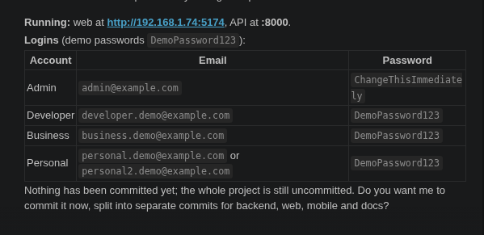

# nexTap

Turn any NFC-enabled Android phone or iPhone into a programmable NFC card reader.

**NFC detection → Card ID → Secure delivery.** The platform reads the card identifier and delivers a
signed event to the developer's endpoint. What the ID *means* (attendance, access, loyalty, ticketing, …)
is entirely up to the developer.

```
NFC card → Android phone / iPhone (Flutter nexTap) → [platform relay | direct] → Developer endpoint
```

## Repository layout

| Path | What | Stack |
|---|---|---|
| [`backend/`](backend/) | REST API, auth, API keys, devices, event logging, signed webhook delivery, usage, billing architecture | Python, FastAPI, SQLAlchemy, PostgreSQL, Redis, JWT |
| [`web/`](web/) | Developer dashboard | React, TypeScript, Tailwind CSS |
| [`mobile/`](mobile/) | nexTap app for Android and iPhone (reader, terminal and digital card) | Flutter, Dart (Android, iOS) |
| [`docs/API_CONTRACT.md`](docs/API_CONTRACT.md) | The API contract shared by all three | — |

## Quick start (local)

```bash
# 1. Postgres + Redis (or use locally installed services)
docker compose up -d postgres redis

# 2. Backend
cd backend && python -m venv .venv && . .venv/bin/activate
pip install -r requirements.txt && cp .env.example .env   # set EMAIL_ENABLED=false for local dev
alembic upgrade head && uvicorn app.main:app --reload     # http://127.0.0.1:8000/docs

# 3. Dashboard
cd web && npm install && cp .env.example .env && npm run dev   # http://localhost:5173

# 4. Mobile (physical Android device with NFC)
cd mobile && flutter run --dart-define=API_BASE_URL=http://<your-lan-ip>:8000
```

Then: register on the dashboard → create an application (copy the API key and webhook secret, shown once) →
set the endpoint → enter the API key in the phone app → tap a card.

## Delivery modes

- **Relay (default):** phone → platform → your endpoint. The platform signs with your webhook secret, logs every
  attempt and retries server-side. The secret never leaves the server.
- **Direct:** phone → your endpoint. The phone signs with a per-device key derived from your webhook secret
  (`HMAC_SHA256(webhook_secret, "device:" + device_id)`), then reports the result to the platform for logging.

Every request carries `X-NFC-Timestamp`, `X-NFC-Nonce`, `X-NFC-Event-Id` and
`X-NFC-Signature: v1=HMAC_SHA256(secret, "{timestamp}.{nonce}.{raw_body}")`. See
[`backend/README.md`](backend/README.md) for verification examples.

## Security note

A card UID is an **identifier, not proof of identity** — many UIDs can be cloned or are randomised.
Every event is marked `security.authenticated = false` / `level = "uid_only"`. Do not use the UID alone for
payments, high-security access control or anything where impersonation matters.
